  

  <a href="#perfil"><b>Perfil</b></a> &nbsp;/&nbsp;
  <a href="#stack"><b>Stack</b></a> &nbsp;/&nbsp;
  <a href="#actividad"><b>Actividad</b></a> &nbsp;/&nbsp;
  <a href="#contacto"><b>Contacto</b></a>

  

## Perfil

> Egresado de la **Licenciatura en Informática**, con experiencia en **desarrollo web y móvil**, **bases de datos** y **despliegue de soluciones en Linux con Docker**.

He participado en distintas etapas del ciclo de vida del software, desde el análisis de requerimientos hasta la implementación, pruebas y puesta en producción.

  
   
  Backend • Frontend • Móvil &nbsp;/&nbsp; Java • Python • C# &nbsp;/&nbsp; React • React Native &nbsp;/&nbsp; Docker • Linux • SQL
   
  <i>Apasionado por la tecnología.</i>

## Stack

### Desarrollo web

**Frontend** 
<a href="https://react.dev/"><kbd>React</kbd></a>
<a href="https://reactnative.dev/"><kbd>React Native</kbd></a>
<a href="https://www.typescriptlang.org/"><kbd>TypeScript</kbd></a>
<a href="https://jinja.palletsprojects.com/"><kbd>Jinja2</kbd></a>
<a href="https://developer.mozilla.org/en-US/docs/Web/HTML"><kbd>HTML5</kbd></a>
<a href="https://developer.mozilla.org/en-US/docs/Web/CSS"><kbd>CSS3</kbd></a>
<a href="https://developer.mozilla.org/en-US/docs/Web/JavaScript"><kbd>JavaScript</kbd></a>
<a href="https://www.figma.com/"><kbd>Figma</kbd></a>

**Backend** 
<kbd>Python</kbd> <kbd>Flask</kbd> <kbd>Node.js</kbd> <kbd>.NET</kbd> <kbd>C#</kbd> <kbd>Java</kbd> <kbd>Kotlin</kbd> <kbd>C</kbd> <kbd>Express</kbd>

### Bases de datos

**SQL / Relacionales** 
<kbd>MySQL</kbd> <kbd>MariaDB</kbd>

**NoSQL / Big Data** 
<kbd>Apache Cassandra</kbd> <kbd>Hadoop</kbd>

### Computación en la nube y DevOps

**Contenerización y orquestación** 
<kbd>Docker</kbd> <kbd>Docker Compose</kbd> <kbd>NGINX</kbd> <kbd>Servidor Apache</kbd> <kbd>MinIO</kbd>

### Sistemas operativos

<kbd>Windows</kbd> <kbd>Linux</kbd> <kbd>Debian</kbd> <kbd>Ubuntu</kbd> <kbd>Arch</kbd> <kbd>Manjaro</kbd> <kbd>Puppy Linux</kbd>

### Herramientas de IA e ingeniería de prompts

<kbd>ChatGPT</kbd> <kbd>GitHub Copilot</kbd> <kbd>Claude</kbd> <kbd>Figma Make</kbd> <kbd>v0</kbd> <kbd>Google Gemini</kbd> <kbd>DeepSeek</kbd>

## Actividad

  

  

  
  

  
  

### Gráfico de contribuciones de GitHub

## Contacto

  
  

